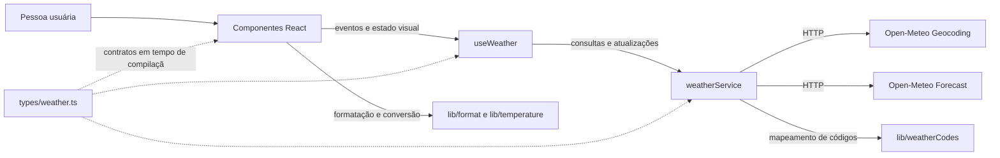

# Plano Técnico — Aplicação de Previsão do Tempo

## Arquitetura (Architecture)

Aplicação web React de página única, sem backend de produto no MVP. A dependência segue uma direção única: apresentação → orquestração → acesso a dados → API externa. Componentes não fazem requisições; serviços não conhecem React; funções puras não acessam rede, estado de interface ou DOM.



**Decisão de integração:** chamar Open-Meteo diretamente do navegador. Não há chave secreta, autenticação ou persistência de usuário que exija um servidor intermediário; isso mantém a implantação simples. Antes do lançamento, validar CORS, limites e termos de uso. Se CORS ou limites impedirem chamadas diretas, reavaliar uma função intermediária sem persistência de dados, registrando essa mudança como decisão de arquitetura.

## Stack Tecnológica (Tech Stack)

| Área | Decisão |
| --- | --- |
| Interface | React 19 + TypeScript strict, servidos por Vite. |
| Estilo | Tailwind CSS, conforme a stack do repositório. |
| Ícones | `lucide-react`; `lib/weatherCodes.ts` mapeia código WMO para rótulo pt-BR e nome do ícone. |
| Rede | `fetch` nativo, `URLSearchParams` e `AbortController`; sem cliente HTTP adicional. |
| Testes unitários e de componentes | Vitest, Testing Library e `user-event`. |
| Testes de ponta a ponta | Playwright, interceptando chamadas externas para dados determinísticos. |
| Qualidade | Biome para lint e formatação; pnpm como gerenciador de pacotes. |
| Dados meteorológicos | Open-Meteo Geocoding e Forecast, sem API key. |

## Estrutura do Projeto

Estrutura-alvo para as tarefas de implementação; criar diretórios ou arquivos que não existam no workspace durante a fase de código.

```text
src/
  App.tsx
  main.tsx
  components/
    SearchBar.tsx
    CityResults.tsx
    CurrentWeather.tsx
    ForecastList.tsx
    ForecastCard.tsx
    UnitToggle.tsx
    states/
      WeatherStatus.tsx
  hooks/
    useWeather.ts
  services/
    weatherService.ts
  lib/
    format.ts
    temperature.ts
    weatherCodes.ts
  types/
    weather.ts
  styles/
    index.css
tests/
  unit/
    weatherService.test.ts
    temperature.test.ts
    weatherCodes.test.ts
    useWeather.test.ts
    App.test.tsx
  e2e/
    weather.spec.ts
```

Responsabilidades: `components/` apresenta dados e estados; `hooks/` orquestra interação e estado; `services/` contém somente integração e validação das respostas externas; `lib/` contém funções puras; `types/` contém contratos compartilhados. Evitar estado global ou uma camada de cache no MVP.

Fronteiras e dependências:

| Camada | Responsabilidade | Pode depender de | Não deve fazer |
| --- | --- | --- | --- |
| `App.tsx` | Compor a tela e conectar o hook aos componentes. | `components/`, `hooks/`, `types/` | Conter protocolo HTTP ou regras de conversão. |
| `components/` | Renderizar props, emitir eventos e apresentar estados acessíveis. | `lib/` para formatação/conversão e `types/` | Chamar `fetch`, interpretar payload Open-Meteo ou manter estado de rede duplicado. |
| `hooks/` | Coordenar busca, seleção, consulta, atualização manual, estado e cancelamento. | `services/`, `types/` | Renderizar marcação ou conhecer formatos brutos da API. |
| `services/` | Construir URLs, executar `fetch`, validar respostas e produzir modelos normalizados. | `lib/weatherCodes`, `types/` | Importar React, componentes ou estado visual. |
| `lib/` | Converter unidades, formatar datas e mapear códigos meteorológicos. | Tipos simples, se necessário | Acessar rede, DOM, hooks ou estado mutável global. |
| `types/` | Declarar contratos compilados entre as camadas. | Nenhuma camada de execução | Conter lógica ou dependências de React. |

Essa separação deixa a UI testável com dados de entrada controlados, a orquestração testável substituindo o serviço e o serviço testável simulando apenas `fetch`. Funções puras podem ser testadas sem DOM, rede ou relógio real.

## Modelo de Dados (Data Model)

Contratos internos normalizados. A resposta externa não deve ser consumida diretamente pelos componentes.

```ts
/** Unidade de temperatura escolhida para a apresentação. */
export type Unit = 'celsius' | 'fahrenheit';

export interface City {
  id: number; // Identificador do local retornado pela geocodificação.
  name: string; // Nome da cidade retornado pela Open-Meteo.
  adminRegion: string | null; // Estado ou região administrativa, quando disponível.
  country: string | null; // País, quando disponível.
  latitude: number; // Latitude usada para consultar a previsão.
  longitude: number; // Longitude usada para consultar a previsão.
}

export interface CurrentWeather {
  temperatureC: number | null; // temperature_2m em Celsius; null quando ausente.
  humidityPercent: number | null; // relative_humidity_2m em porcentagem.
  windSpeedKmh: number | null; // wind_speed_10m em km/h.
  precipitationMm: number | null; // precipitation acumulada na última hora, em mm.
  surfacePressureHpa: number | null; // surface_pressure em hPa.
  weatherCode: number | null; // weather_code atual segundo o código WMO.
  conditionPtBr: string; // Rótulo pt-BR mapeado do código; fallback “Condição indisponível”.
  observedAt: string | null; // time da observação em ISO 8601 no fuso retornado.
}

export interface ForecastDay {
  date: string; // time da previsão diária no formato YYYY-MM-DD.
  minimumC: number | null; // temperature_2m_min em Celsius; null quando ausente.
  maximumC: number | null; // temperature_2m_max em Celsius; null quando ausente.
  precipitationProbabilityPercent: number | null; // precipitation_probability_max em porcentagem.
  weatherCode: number | null; // weather_code diário segundo o código WMO.
  conditionPtBr: string; // Rótulo pt-BR mapeado do código; fallback “Condição indisponível”.
}

export interface WeatherData {
  city: City; // Local selecionado pela pessoa.
  timezone: string | null; // Fuso IANA; null quando a resposta parcial omite o metadado.
  current: CurrentWeather | null; // Bloco current normalizado; null se ausente.
  forecast: ForecastDay[]; // Cinco dias quando há referência de calendário; [] se a seção está indisponível.
}

export type WeatherErrorKind = 'network' | 'http' | 'timeout' | 'invalid-response';

export interface WeatherError {
  kind: WeatherErrorKind;
  messagePtBr: string;
}
```

Regras do contrato:

- Temperaturas são mantidas em Celsius; conversão para Fahrenheit ocorre somente na apresentação.
- Umidade relativa é expressa em %, vento em km/h, precipitação da última hora em mm, pressão à superfície em hPa e probabilidade máxima diária de precipitação em %.
- Campos ausentes usam `null`, nunca zero. Uma previsão válida contém cinco itens, um por data, mesmo se algum campo daquele dia estiver indisponível.
- Hardening: se apenas uma seção vier válida, ela permanece visível. Datas diárias faltantes são preenchidas a partir da posição da primeira data válida, sem deslocar valores entre dias; seus campos ficam `null`. Sem referência de calendário, a previsão fica indisponível. Sem qualquer seção utilizável, a resposta gera erro recuperável.
- O fuso ausente permanece `null` e sinaliza resposta parcial, sem inventar UTC como fuso da cidade. Horários civis sem offset mantêm os componentes locais da API; instantes com offset só são convertidos quando o fuso da cidade está disponível.
- `conditionPtBr` contém a tradução de códigos WMO conhecidos; código desconhecido usa “Condição indisponível”. O código bruto não é exibido.
- `observedAt` é o horário informado pela fonte e apresentado no fuso local da cidade.
- Datas diárias usam o formato `YYYY-MM-DD`; a apresentação localizada em pt-BR é responsabilidade de `lib/format.ts`.
- `WeatherData.timezone` vem da resposta Forecast; todas as cinco datas são interpretadas nesse fuso.

Estados mínimos da interface, mantidos no hook:

```ts
export type SearchState =
  | { status: 'idle' }
  | { status: 'loading' }
  | { status: 'success'; cities: City[] }
  | { status: 'empty' }
  | { status: 'error'; error: WeatherError };

export type WeatherState =
  | { status: 'idle' }
  | { status: 'loading'; city: City }
  | { status: 'success'; data: WeatherData }
  | { status: 'partial'; data: WeatherData }
  | { status: 'error'; city: City; error: WeatherError };
```

## Fluxo de Dados (Data Flow)

```mermaid
flowchart TD
  Input[Input de busca] --> EmptyQuery{Entrada vazia?}
  EmptyQuery -- Sim --> LocalValidation[Solicita uma cidade; não envia requisição]
  EmptyQuery -- Não --> SearchHook[useWeather: SearchState.loading]
  SearchHook --> GeoService[weatherService.searchCities]
  GeoService --> GeocodingAPI[Open-Meteo Geocoding]
  GeocodingAPI -- Falha de rede ou HTTP --> SearchError[SearchState.error]
  GeocodingAPI -- Sucesso --> HasResults{Há resultados?}
  HasResults -- Não --> SearchEmpty[SearchState.empty]
  HasResults -- Sim --> SearchSuccess[SearchState.success: City[]]
  SearchSuccess --> ChooseCity[CityResults: seleção explícita]
  ChooseCity --> WeatherHook[useWeather: WeatherState.loading; invalida solicitação anterior]
  WeatherHook --> ForecastService[weatherService.getWeather]
  ForecastService --> ForecastAPI[Open-Meteo Forecast]
  ForecastAPI -- Rede, HTTP ou timeout de 10 s --> WeatherError[WeatherState.error]
  ForecastAPI -- Sem dados utilizáveis --> WeatherError
  ForecastAPI -- Dados parciais --> PartialState[WeatherState.partial]
  ForecastAPI -- Dados completos --> SuccessState[WeatherState.success]
  SearchEmpty --> EmptyUI[EmptyState: permite nova busca]
  SearchError --> SearchErrorUI[ErrorState: repetir busca manualmente]
  SearchErrorUI --> SearchHook
  WeatherError --> WeatherErrorUI[ErrorState: repetir consulta manualmente]
  WeatherErrorUI --> WeatherHook
  PartialState --> PartialUI[CurrentWeather / ForecastList: campos ausentes como indisponíveis]
  SuccessState --> WeatherUI[CurrentWeather / ForecastList / ForecastCard]
  EmptyUI --> Input
```

- `weatherService` codifica a consulta com `URLSearchParams` e normaliza respostas; componentes não acessam a API.
- `SearchState.empty` representa geocodificação bem-sucedida sem resultados; falhas de serviço são `error`.
- Resposta parcial mantém os dados válidos e campos ausentes como `null`; resposta tardia de uma cidade anterior é descartada.
- A unidade é mantida na sessão e convertida na renderização; alternar Celsius/Fahrenheit não retorna ao serviço.
- Atualização manual da cidade selecionada repete Forecast. Não há atualização automática, cache ou retentativa automática no MVP.

## APIs Externas

### Geocodificação

- **URL:** `https://geocoding-api.open-meteo.com/v1/search`
- **Parâmetros:** `name` recebe o termo enviado e deve ser codificado com `URLSearchParams`; `count=10` limita os resultados; `language=pt` solicita nomes em português; `format=json` solicita JSON. `current`, `daily` e `timezone` não se aplicam a este endpoint.
- **Exemplo resumido de resposta:**

```json
{
  "results": [
    {
      "id": 3448439,
      "name": "São Paulo",
      "latitude": -23.55,
      "longitude": -46.63,
      "admin1": "São Paulo",
      "country": "Brasil"
    }
  ]
}
```

- **Mapeamento para `City`:** `id` → `id`; `name` → `name`; `admin1` → `adminRegion`; `country` → `country`; `latitude` → `latitude`; `longitude` → `longitude`. Campos de região ou país ausentes tornam-se `null`. Normalizar todos os resultados; lista ausente ou vazia resulta em busca sem correspondências e não inicia Forecast.

### Clima atual e previsão

- **URL:** `https://api.open-meteo.com/v1/forecast`
- **Parâmetros:** `latitude` e `longitude` vêm da cidade selecionada; `current=temperature_2m,relative_humidity_2m,wind_speed_10m,precipitation,surface_pressure,weather_code` solicita métricas atuais; `daily=temperature_2m_min,temperature_2m_max,precipitation_probability_max,weather_code` solicita resumo diário; `forecast_days=5` define hoje e mais quatro dias; `timezone=auto` usa o fuso local inferido das coordenadas; `temperature_unit=celsius`, `wind_speed_unit=kmh` e `precipitation_unit=mm` definem as unidades internas.
- **Exemplo resumido de resposta:**

```json
{
  "latitude": -23.55,
  "longitude": -46.63,
  "timezone": "America/Sao_Paulo",
  "current": {
    "time": "2026-10-29T13:15",
    "temperature_2m": 22.4,
    "relative_humidity_2m": 68,
    "wind_speed_10m": 12.4,
    "precipitation": 0.1,
    "surface_pressure": 927.0,
    "weather_code": 1
  },
  "daily": {
    "time": ["2026-10-29", "2026-10-30", "2026-10-31", "2026-11-01", "2026-11-02"],
    "temperature_2m_min": [18.0, 19.0, 18.5, 17.0, 16.0],
    "temperature_2m_max": [26.5, 27.0, 26.0, 24.5, 25.0],
    "precipitation_probability_max": [10, 25, 60, 80, 5],
    "weather_code": [1, 3, 2, 61, 0]
  }
}
```

- **Mapeamento para `WeatherData`:** `city` é o objeto `City` selecionado; raiz `timezone` → `WeatherData.timezone`; `current.temperature_2m`, `relative_humidity_2m`, `wind_speed_10m`, `precipitation`, `surface_pressure`, `weather_code` e `time` mapeiam para os campos homônimos normalizados de `CurrentWeather`, com as conversões de unidade documentadas.
- Para cada índice `i` de `daily.time`, criar um `ForecastDay`: `time[i]` → `date`; `temperature_2m_min[i]` → `minimumC`; `temperature_2m_max[i]` → `maximumC`; `precipitation_probability_max[i]` → `precipitationProbabilityPercent`; `weather_code[i]` → `weatherCode` e rótulo pt-BR. Associar arrays pelo mesmo índice, nunca pela ordem de campos do objeto.
- Fazer uma chamada de Forecast por seleção ou atualização manual para obter clima atual e previsão juntos. Não solicitar previsão horária. Se um campo estiver ausente, normalizar para `null`; se não houver nenhum dado meteorológico utilizável, tratar como resposta inválida/indisponível.
- Antes da distribuição pública, validar termos, limites, atribuição e disponibilidade do provedor, conforme a pendência de conformidade na especificação.

## Gerenciamento de Estado

O estado vive localmente em React, sem Redux, contexto global, armazenamento no navegador ou servidor:

- `SearchBar` mantém apenas o texto ainda não enviado. Ao enviar, o hook passa a controlar `SearchState`: `idle` antes da primeira busca, `loading` durante a chamada, `success` com resultados, `empty` para resposta válida sem cidades e `error` para falha.
- `useWeather` mantém `SearchState`, cidade selecionada e `WeatherState`: `idle`, `loading`, `success`, `partial` ou `error`. `empty` é exclusivo da busca; falta de correspondências não é erro HTTP. Resposta meteorológica sem nenhum dado utilizável é `error`, enquanto dados utilizáveis incompletos são `partial`.
- `App` mantém `Unit`, inicializado como `celsius`, e passa o valor e a ação de alternância aos componentes que exibem temperatura. O valor não é persistido.
- `WeatherData` permanece em Celsius e não é mutado pela conversão. `lib/temperature.ts` recebe Celsius e unidade e devolve o número para exibição; os componentes chamam essa função ao renderizar. Alternar a unidade atualiza a tela sem novo request, sem mudança do estado de rede e sem alteração do modelo normalizado.
- Busca explícita controla a geocodificação; não há busca a cada tecla. Seleção nova ou atualização manual transita para `loading`, invalida os dados anteriores como atuais e inicia uma solicitação.
- Usar `AbortController` e identidade da solicitação para cancelar ou ignorar respostas fora de ordem. Cancelamento por nova seleção não vira `error` visível.
- Cada chamada expira após 10 segundos. Não há retentativa automática; nova tentativa é iniciada pela pessoa.

## Tratamento de Erros (Error Handling)

| Situação | Tratamento |
| --- | --- |
| Campo vazio | Não chamar API; manter busca disponível e solicitar uma cidade. |
| Geocodificação sem resultados | Exibir estado vazio em pt-BR; não consultar Forecast. |
| Falha de rede | Transitar para `error` com tipo `network`; encerrar carregamento, mostrar mensagem recuperável em pt-BR e oferecer nova tentativa manual. |
| Erro HTTP ou limite do provedor | Transitar para `error` com tipo `http`; não exibir o corpo técnico da API, não repetir automaticamente e permitir nova tentativa manual. |
| Timeout | Após 10 segundos, cancelar a solicitação e transitar para `error` com tipo `timeout`; ignorar resposta tardia e permitir nova tentativa manual. |
| Resposta inválida ou sem dados utilizáveis | Transitar para `error` com tipo `invalid-response`; não representar valores ausentes como zero. |
| Resposta parcial | Transitar para `partial`; manter seções e campos válidos, representar os ausentes como `null` e mostrar “Indisponível”. Não reutilizar dados da cidade ou solicitação anterior. |
| Código meteorológico desconhecido | Exibir “Condição indisponível”, sem código bruto. |
| Resposta de cidade anterior | Descartar se não corresponder à seleção atual. |
| Erro inesperado | Transitar para `error`, exibir mensagem genérica e ação de nova tentativa; registrar somente métrica operacional agregada, sem texto da consulta ou identificador de usuário. |

## Estratégia de Testes (Testing Strategy)

- **Funções puras (`lib/`, Vitest):** testar Celsius↔Fahrenheit, limites de conversão, valores nulos, formatação de datas e mapeamento de rótulos/ícones WMO. Testes determinísticos, sem DOM, rede ou relógio real.
- **Acesso a dados (`services/`, Vitest):** substituir `fetch` por mocks; verificar URLs, parâmetros e normalização de respostas. Cobrir geocodificação com resultados/sem resultados, acentos e caracteres especiais, respostas válidas/parciais, HTTP 429/5xx, falha de rede, timeout de 10 segundos e cancelamento. Nenhum teste unitário chama Open-Meteo real.
- **Orquestração (`hooks/`, Testing Library):** substituir `weatherService` e verificar transições `idle → loading → success`, `empty` e `error`; no clima, verificar `idle/loading/success/partial/error`, atualização manual, unidade em memória, timeout e descarte de respostas fora de ordem.
- **Apresentação (`components/`, Testing Library):** renderizar com props controladas; `CurrentWeather` verifica temperatura/unidade, ícone, condição e métricas com unidades; `ForecastList`/`ForecastCard` verifica rótulo do dia, ícone, mínima/máxima e probabilidade de chuva. Cobrir também loading, vazio, erro, parcial, retry e acessibilidade.
- **Ponta a ponta (Playwright):** cobrir fluxos representativos de US-01 a US-07 com `page.route` para geocodificação e Forecast: buscar, selecionar, exibir clima e cinco dias, atualizar manualmente, alternar unidades, receber vazio/erro/parcial e ignorar resposta atrasada. Testes nunca dependem da API real.
- **Viewports:** executar o fluxo principal em 320 e 375 px (mobile) e em 768, 1024 e 1440 px; em mobile, verificar ausência de rolagem horizontal e acesso por toque. Rodar nos navegadores da matriz RNF-06.
- **Acessibilidade:** combinar verificações automatizadas com revisão manual por teclado e leitor de tela nos fluxos principais, conforme RNF-03.
- **Validação de usabilidade:** teste moderado com 10 participantes representativos; aceite quando pelo menos 8 concluírem busca, clima atual e previsão sem ajuda em até 90 segundos.
- **Dependências externas:** fazer verificação manual pré-lançamento de CORS, termos, limites e atribuição da Open-Meteo; testes automatizados não chamam a API real.

## Riscos e Compensações

| Decisão | Alternativa considerada | Trade-off e justificativa |
| --- | --- | --- |
| Chamadas diretas do navegador à Open-Meteo | Serviço intermediário próprio | Menos infraestrutura e sem segredo de API para proteger; expõe ao provedor a localidade consultada e depende de CORS/limites. Validar antes da distribuição; introduzir intermediário somente se necessário e sem persistência de usuário. |
| `fetch` nativo | Cliente HTTP adicional | Evita dependência e é suficiente para dois endpoints; biblioteca poderia simplificar interceptores/retries, recursos que o MVP não precisa. |
| Sem cache e sem atualização automática | Cache com TTL e atualização periódica | Evita dados vencidos e lógica de invalidação; pode aumentar latência e reduzir disponibilidade percebida. O timeout de 10 segundos, estados explícitos e atualização manual são o compromisso do MVP. |
| Resumo diário de cinco dias | Previsão horária ou período maior | Menos dados, chamadas e densidade visual; não atende planejamento intradiário ou viagens além de cinco dias, explicitamente fora do MVP. |
| Estado local em `App`/hook | Redux ou outro estado global | Menos configuração e fluxo suficiente para uma tela; estado global só se justifica se surgirem múltiplas áreas independentes ou compartilhamento persistente. |
| Unidade somente em memória | `localStorage` ou preferência no servidor | Evita persistência e simplifica privacidade; a unidade volta a Celsius ao recarregar, conforme aprovado. |
| Uma resposta Forecast para clima atual e dias | Chamadas independentes para atual e previsão | Uma requisição reduz latência e coordenação de estado; chamadas independentes permitiriam sucesso parcial por endpoint, mas aumentariam complexidade. A resposta parcial ainda é tratada por campo/seção. |
| Cobertura global com seleção explícita | Selecionar automaticamente o primeiro resultado ou limitar países | Amplia alcance sem escolher silenciosamente a cidade errada; exige escolha adicional quando há homônimos. |
| Validar termos antes da publicação | Trocar de provedor preventivamente | Manter Open-Meteo honra a decisão aprovada; revisão de termos/atribuição é gate e uma incompatibilidade pode exigir substituição. |

## Rastreabilidade

| Parte do plano | Especificação atendida |
| --- | --- |
| Busca e seleção | RF-01/RF-02; US-01; AC-01.1–AC-01.4 e AC-02.1–AC-02.3 |
| Clima atual e atualização | RF-03; US-02; AC-03.1–AC-03.2 |
| Previsão diária | RF-04; US-03; AC-04.1–AC-04.2 |
| Unidade e rótulos | RF-05/RF-06; US-04/US-05; AC-05.1–AC-05.3 e AC-06.1 |
| Localização e estados | RF-07/RF-08; US-06/US-07; AC-07.1–AC-07.2 e AC-08.1–AC-08.5 |
| Qualidade operacional | RNF-01–RNF-09 |